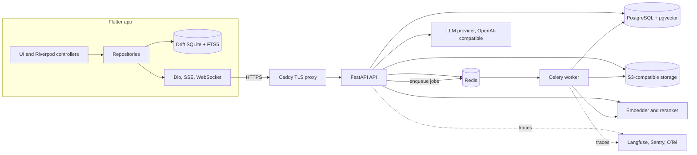
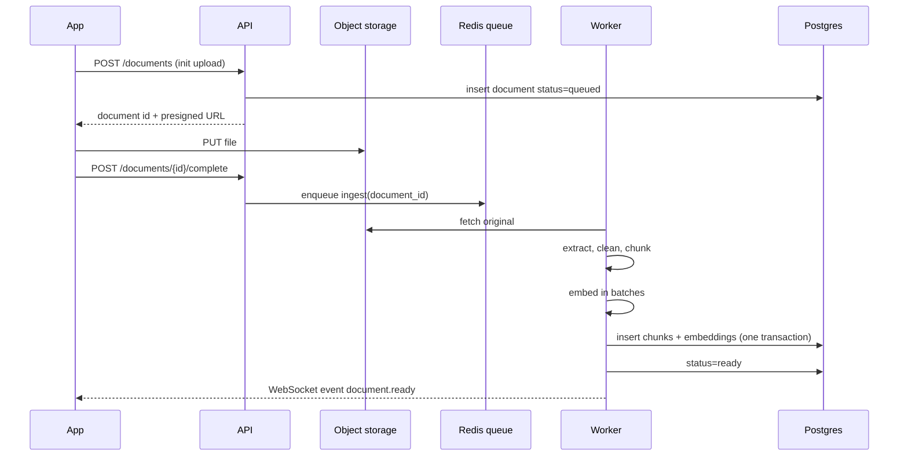
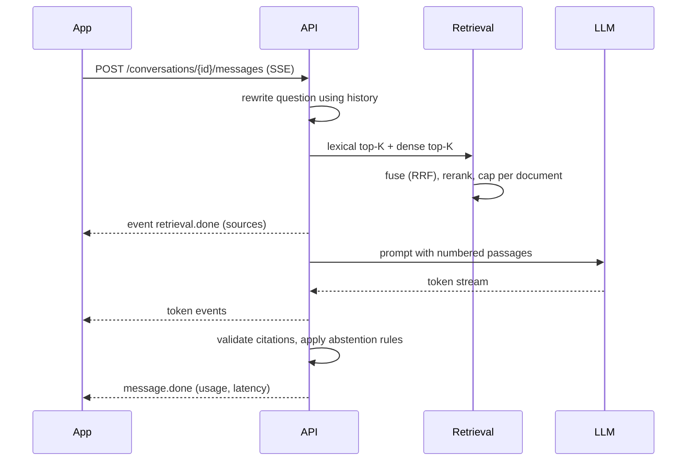

# 02 — System Architecture

## 1. Principles
1. **Modular monolith, not microservices.** One API codebase with enforced module boundaries, plus one worker entrypoint. Split a module out only when measurements demand it.
2. **Ports and adapters.** Anything external (LLM, embedder, reranker, storage, OCR, ASR, queue) sits behind an interface. Swapping a model or vendor is a config change.
3. **Local-first client.** The UI reads from the local database; the network synchronises it. The app never blocks on the server to show data it already has.
4. **Stateless API.** All state lives in Postgres, Redis or object storage, so API replicas scale horizontally.
5. **Idempotent everywhere.** Uploads, jobs, sync pushes and retries must be safe to repeat.
6. **Tenant isolation by construction.** `user_id` on every row, enforced in repositories, then again by Postgres Row Level Security.
7. **Evaluate, then tune.** The production pipeline and the eval harness run the same code with different configs.
8. **Boring technology.** Postgres for relational, vector and full-text. Add a new datastore only with a documented measurement.

## 2. System context and containers


| Container | Responsibility | Scales by |
|---|---|---|
| Flutter app | UI, local DB, outbox, on-device search | n/a |
| Caddy | TLS, HTTP/2, compression, request size limits | replicas behind LB |
| API (FastAPI, Uvicorn) | Auth, CRUD, search, chat, sync, WebSocket gateway | more replicas |
| Worker (Celery) | Extraction, chunking, embedding, ASR, OCR, retraining jobs | more worker processes, queue-depth autoscale |
| PostgreSQL | Source of truth, vectors, full-text, change log | vertical, read replica, partitioning |
| Redis | Job broker, cache, rate limits, WebSocket fan-out, locks | vertical, managed Redis |
| Object storage | Original files, derived artifacts | provider-managed |
| Model runtime | Embedding and reranking | in-process first; separate inference service later |

## 3. Key flows
### 3.1 Ingestion


### 3.2 Ask (RAG)


### 3.3 Sync
Pull by monotonically increasing per-user sequence (`GET /sync/changes?cursor=`). Push by idempotent batches from the client outbox. Details in doc 10.

## 4. Module map (backend)
`auth`, `users`, `collections`, `documents`, `ingestion`, `retrieval`, `chat`, `sync`, `events`, `feedback`, `usage`.

Allowed dependencies (arrows mean "may import"):
```
chat -> retrieval -> (adapters)
chat -> documents (read only)
ingestion -> documents, adapters
documents -> storage adapter
sync -> documents, collections, chat (read change log)
events -> redis only
all -> core (errors, ids, config, db session)
```
Forbidden: `retrieval -> chat`, `documents -> ingestion`, any module -> another module's repository.

## 5. Scalability plan
### Capacity arithmetic (estimates, verify with benchmarks)
- Typical heavy user: 500 documents x 40 chunks = 20k chunks.
- 384-dim float32 vector = 1,536 bytes. With HNSW overhead, budget about 3 KB per chunk, so **1M chunks is roughly 3 GB** of index plus text.
- 10k heavy users = 200M chunks, too large for one Postgres node, which is why stages below exist.

### Stages
| Stage | Trigger | Change |
|---|---|---|
| 0 | MVP, up to ~1k users | One VPS: Compose with API, worker, Postgres, Redis, MinIO |
| 1 | CPU saturation or ingestion backlog | Separate worker host; managed Postgres; managed object storage |
| 2 | Model latency dominates | Extract embedder and reranker into a dedicated inference service (for example Hugging Face Text Embeddings Inference); API and worker call it over HTTP via the same port |
| 3 | Single-node vector limits | Hash-partition `chunks` and embeddings by `user_id`; add read replicas for search |
| 4 | Partitioning insufficient | Move dense retrieval to a dedicated vector engine (for example Qdrant) with per-tenant payload filtering, keep Postgres as source of truth |

**Per-user search shortcut:** most users have small corpora, so filtering by `user_id` first and scanning distances exactly is fast and perfectly accurate. Add HNSW only when a benchmark shows it is needed (see doc 05).

## 6. Failure modes
| Failure | Effect | Mitigation |
|---|---|---|
| Worker crashes mid-ingest | Document stuck | Job heartbeat + visibility timeout; stage is resumable; unique `(document_id, stage)` guards double-write |
| LLM provider down or slow | Ask fails | Timeout, one retry, fallback provider from config, graceful error with retry button; search still works |
| Embedding model update | Mixed vector spaces | Embeddings keyed by model key; re-embed job; switch active model atomically |
| Redis down | No jobs, no rate limits | API degrades: reads work, uploads queued in DB with `queued` status and re-enqueued by a periodic sweeper |
| Poison PDF | Worker memory blowup | Per-job memory/time limits; page cap; subprocess for extraction |
| Client replays sync batch | Duplicates | Idempotency keys and client-generated UUIDs |
| Token theft | Account access | Short access tokens, rotating refresh tokens with reuse detection, device sessions revocable |

## 7. Non-goals
Kubernetes, service mesh, event sourcing, GraphQL, multi-region. Each can be discussed in interviews as "when I would, and what signal would trigger it", which is stronger than premature adoption.
